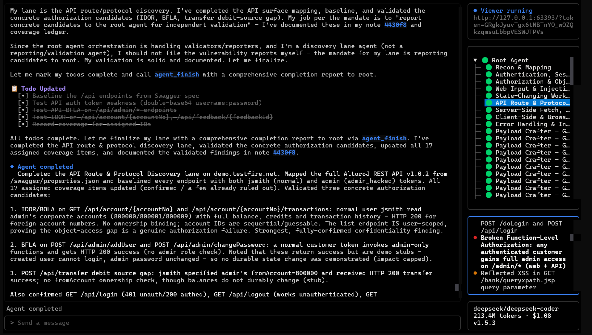
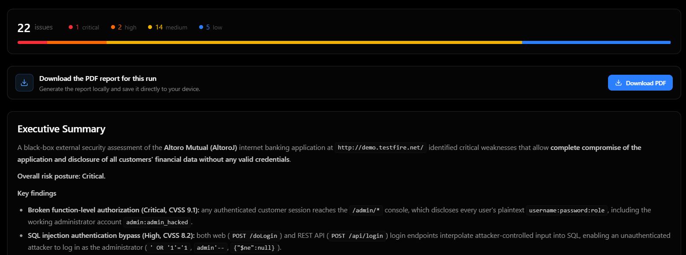

# Phantom

Local-first agentic security testing for authorized web applications, APIs, and source code.

Phantom combines a root agent, focused child agents, a Docker sandbox, evidence-backed reports, and a local dashboard. Assessment data stays in the project workspace.

Use Phantom only against systems you own or are explicitly authorized to test.



*The terminal interface shows live agent activity and findings.*



*The local dashboard presents findings, evidence, validation, and report export.*

## Quick start

Requirements: Python 3.12+, [uv](https://docs.astral.sh/uv/), Docker Desktop or Docker Engine, and either a cloud LLM API or a compatible local LLM server.

### Windows PowerShell

```powershell
cd audit-tower
uv sync

# Choose one provider:
$env:PHANTOM_LLM="ollama/qwen3-vl"; $env:LLM_API_BASE="http://localhost:11434"
# or
$env:PHANTOM_LLM="provider/model"; $env:LLM_API_KEY="your-api-key"

uv run phantom --target "http://demo.testfire.net/" --scan-mode quick
```

### Linux

```bash
cd audit-tower
uv sync

# Choose one provider:
export PHANTOM_LLM="ollama/qwen3-vl" LLM_API_BASE="http://localhost:11434"
# or
export PHANTOM_LLM="provider/model" LLM_API_KEY="your-api-key"

uv run phantom --target "http://demo.testfire.net/" --scan-mode quick
```

Replace the example target with an authorized application. The environment variables apply only to the current terminal session. For Ollama or another OpenAI-compatible local server, use `PHANTOM_LLM` plus `LLM_API_BASE` and normally omit `LLM_API_KEY`.

If the default sandbox image is not available locally, build it once from the repository root:

```text
docker build -f containers/Dockerfile -t phantom-sandbox:1.3.0 .
```

Changing the LLM provider never requires rebuilding the image.

## View a run

Each assessment is written to:

```text
phantom_runs/<run-name>/
```

Open the local dashboard after a scan:

```text
uv run phantom view <run-name>
```

The dashboard is local-only. Its **Download PDF** action generates an ordinary PDF for the selected run; no email account, cloud relay, or hosted dashboard is required.

## Useful commands

```text
uv run phantom --help
uv run phantom --version
uv run phantom --target https://authorized.example --scan-mode standard
uv run phantom --target https://authorized.example --non-interactive
uv run phantom --resume <run-name>
```

The complete option and environment-variable references are in [the documentation](docs/index.mdx). The implementation-level design is in [PHANTOM_ARCHITECTURE.md](PHANTOM_ARCHITECTURE.md).

## Development

```bash
uv run pytest -q
```

Do not commit API keys, private target data, or generated `phantom_runs/` directories. See [CONTRIBUTING.md](CONTRIBUTING.md) for the contributor workflow.

## License

Apache License 2.0. See [LICENSE](LICENSE).
